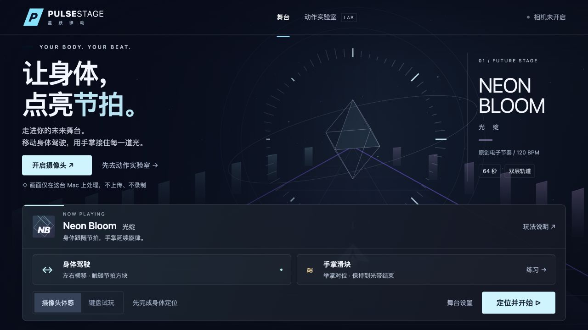
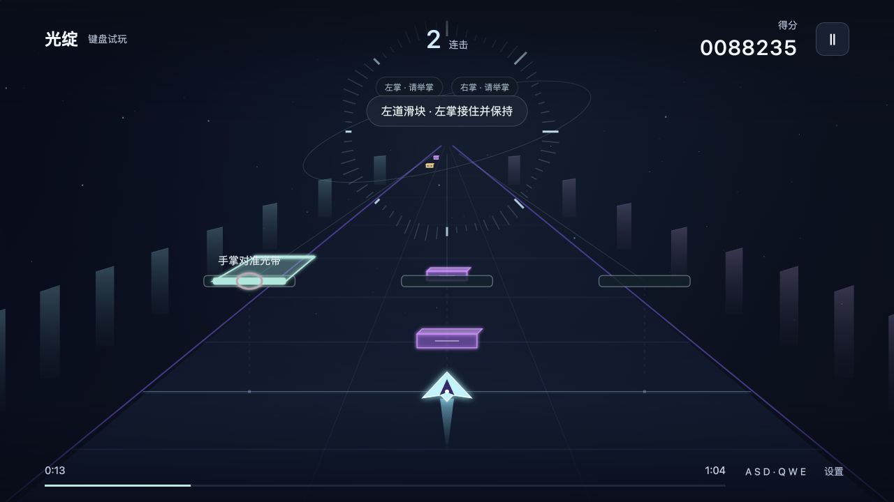
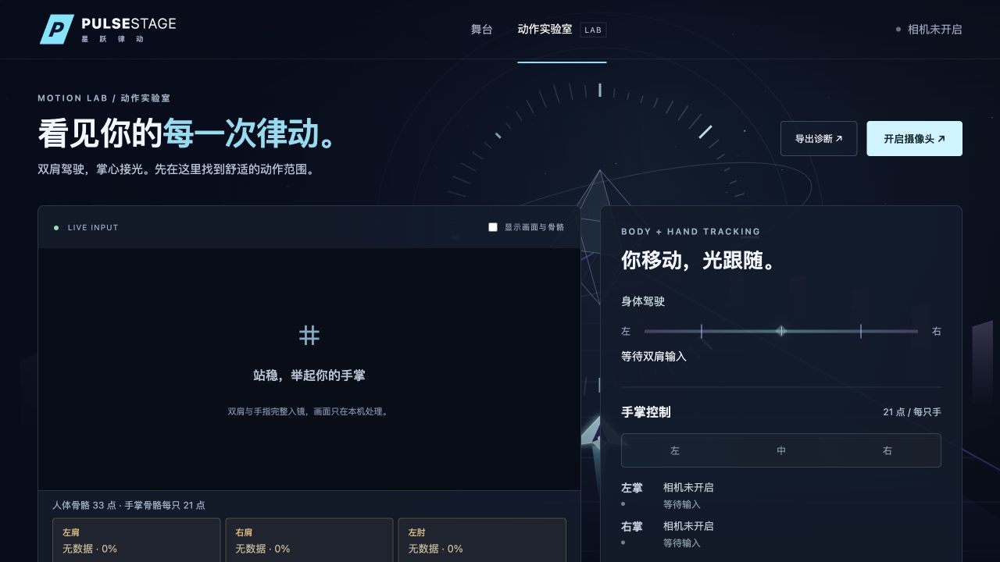
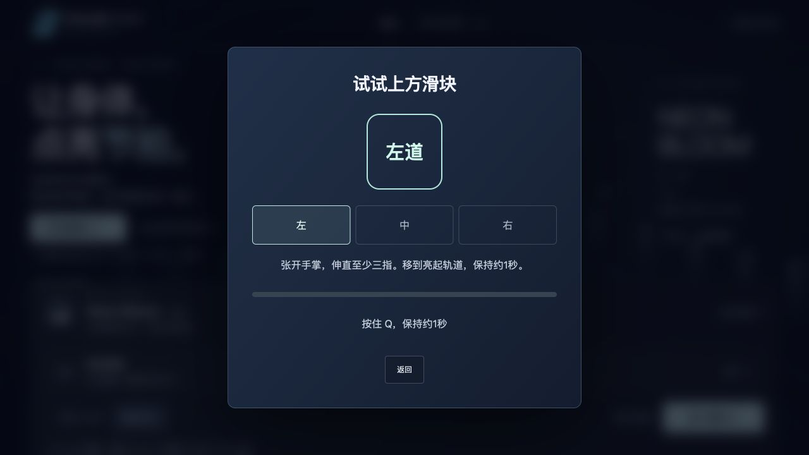
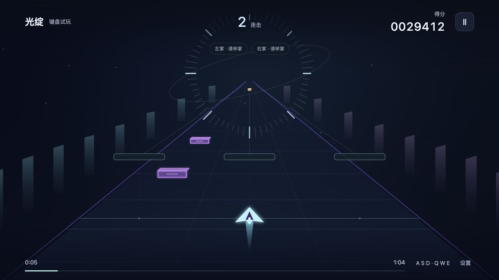
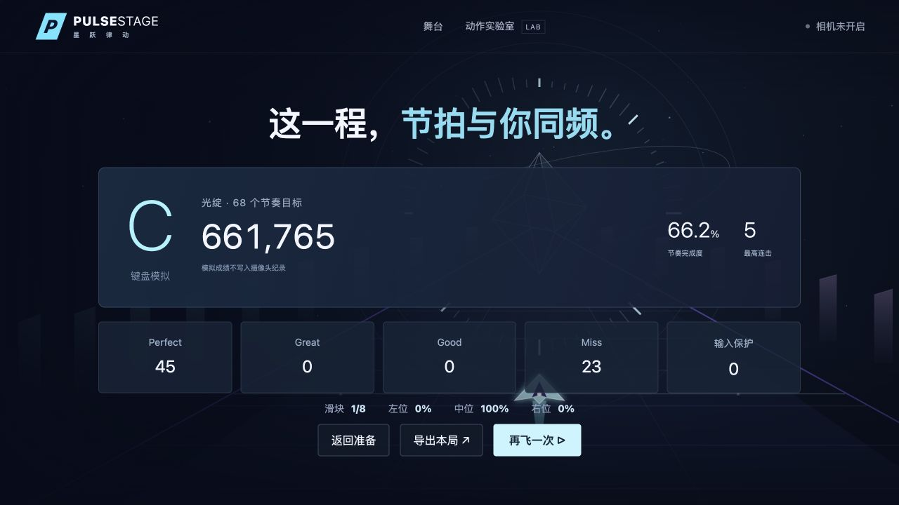
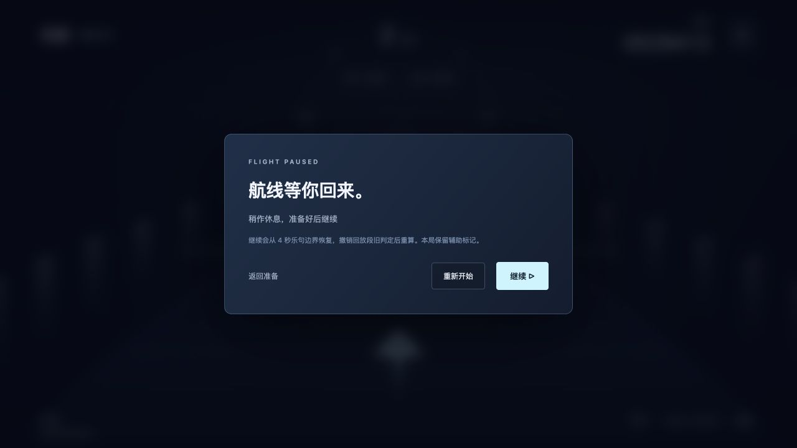
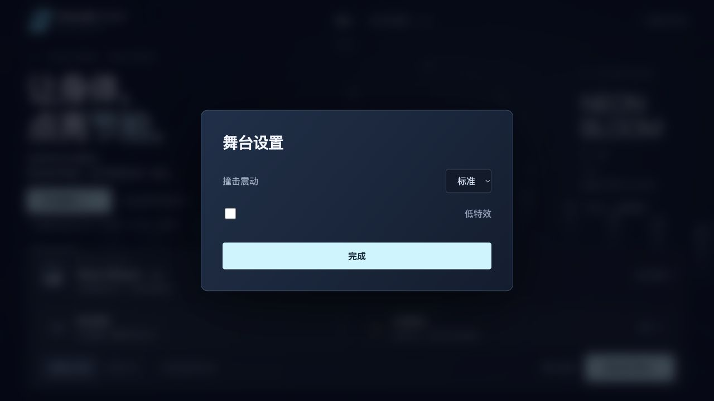
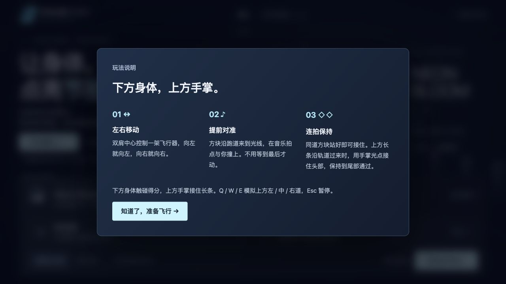

# Pulse Stage · 星跃律动

**用身体驾驶，用手掌接光。** 一个面向 Mac 优先验证的浏览器体感节奏游戏原型：只需要电脑摄像头，不需要手柄或穿戴设备。

当前版本 **v0.5.0** · 64 秒原创电子音乐 · 下层身体方块 + 上层手掌长条 · 本机人体与手部识别。

[下载完整试玩包](https://github.com/ShareenSONG/pulse-stage/releases/latest) · [查看所有界面](#界面一览) · [快速运行](#快速运行) · [需求说明](docs/requirements/星跃律动_需求增补_v1.7_未来舞台与手掌识别.md) · [验证记录](VERIFICATION.md)



> 当前仓库提供源码与本机试玩包，尚未部署在线试玩网站。截图中的游戏过程采用键盘模拟，动作实验室截图关闭摄像头预览，不包含真人影像。真人手掌识别精度仍在持续验证。

## 游戏玩法

### 下层：身体驾驶，跟随节拍撞块

正面站稳并完成左右活动范围定位。双肩中心控制一架飞行器：身体向左，飞行器向左；身体向右，飞行器向右。

方块沿左、中、右三道向你靠近，**在音乐拍点到达固定判定线**。提前移动到目标位置即可触碰得分，同道连续方块可以保持站位接住，不必临时甩手或反复摇晃。

### 上层：举起手掌，接住整条光带

在下层轨道上方，长条滑块随旋律靠近。张开手掌、伸直至少三根非拇指手指，举到肩部附近，用掌心光点对准长条头部，保持至尾部通过。

| 上层轨道 | 使用的手 |
|---|---|
| 左道 | 左掌 |
| 中道 | 任意一只手，独立保持完整时段 |
| 右道 | 右掌 |

身体和手掌分别操作上下两层。当前“掌推”是**举掌对位并停留**，无需向摄像头真实前推，也不判断 Z 轴前后距离。



### 一首歌的循环

**选择曲目与输入方式 → 身体定位 → 倒数 → 64 秒演奏 → 成绩结算 → 重试。**

当前曲目为程序生成的原创合成音乐 **Neon Bloom / 光绽**，120 BPM。一局包含 **60 个身体方块 + 8 条手掌滑块，共 68 个评分单位**，总分归一化至 1,000,000。

- 身体方块根据拍点时的位置误差评为 Perfect / Great / Good / Miss。
- 手掌滑块根据有效保持覆盖率判分：95% / 85% / 65% 分别对应 Perfect / Great / Good。
- Perfect、Great 延续连击；普通失误继续演奏。识别缺失或过期会触发输入保护，不能用冻结光点持续得分。
- Esc 暂停。恢复时从 4 秒乐句边界回放，并撤销该回放段旧判定，避免重复计分。

## 界面一览

<table>
<tr>
<td width="50%"><b>动作实验室 LAB</b><br>检查双肩、双臂与手掌状态，查看推理帧率与耗时，重新定位。<br></td>
<td width="50%"><b>滑块练习</b><br>依次练左、中、右三道，先掌握对位和保持。<br></td>
</tr>
<tr>
<td><b>游戏舞台</b><br>固定判定线、独立上下层控制，命中碎片、光晕和连击反馈。<br></td>
<td><b>成绩结算</b><br>查看得分、等级、连击、各道完成率，支持重试与导出报告。<br></td>
</tr>
<tr>
<td><b>暂停与恢复</b><br>中断时冻结音乐与时间，恢复采用乐句回放。<br></td>
<td><b>舞台设置</b><br>切换撞击震动强度与低特效。<br></td>
</tr>
<tr>
<td colspan="2"><b>玩法说明</b><br>在首页随时查看双层操作方法。<br></td>
</tr>
</table>

## 快速运行

### 直接试玩下载包

1. 在 [Releases](https://github.com/ShareenSONG/pulse-stage/releases/latest) 下载完整 ZIP 并解压。
2. 先安装 [Node.js](https://nodejs.org/) **22 或更新的受支持版本**。
3. Mac 双击 `启动游戏-Mac.command`；Windows 双击 `启动游戏-Windows.bat`。
4. 浏览器会打开本机地址。允许摄像头，按提示定位；也可先切换“键盘试玩”。

下载包包含构建好的游戏、所有模型与 WASM、源码和截图，**不需要重新编译或安装游戏依赖**。安装 Node.js 后，本机试玩不需要访问外网；保持启动窗口运行，结束时按 Ctrl+C。Windows 脚本已提供，尚未在 Windows 实机验收。

### 从源码开发

```bash
git clone https://github.com/ShareenSONG/pulse-stage.git
cd pulse-stage
npm ci
npm run dev
```

打开 [http://127.0.0.1:5188/](http://127.0.0.1:5188/)。模型与运行资源已包含在 `public/`，首次开发无需额外下载。端口被占用时，先关闭另一个本项目服务，或为 Vite 指定其他端口。

```bash
npm test          # 自动回归测试
npm run build     # TypeScript 检查与生产构建
npm run preview   # 本机预览构建产物（5188 端口）
npm run assets    # 需要时重新准备模型/WASM和谱面
```

不要直接双击 `index.html` 启动；相机、Worker、模型和 WASM 需要通过本机 Web 服务加载。若部署网页，将 `dist/` 的内容发布到 **HTTPS 网站根目录**；当前资源使用根路径，不支持直接挂到任意子目录。

## 操作与游玩准备

| 操作 | 摄像头体感 | 键盘试玩 |
|---|---|---|
| 下层向左 / 回中 / 向右 | 身体左右横移 | A / S / D，也支持方向键 |
| 上层左 / 中 / 右滑块 | 左掌 / 任意一掌 / 右掌 | 按住 Q / W / E |
| 暂停 | 点击暂停按钮 | Esc |
| 菜单操作 | 右掌光标停留，或鼠标点击 | 鼠标点击 |

固定电脑，面向摄像头，双肩和手指完整入镜，左右留出舒适活动空间。不要靠快速前后移动或侧转操控；本版本只验证 X/Y 操作。

建议首次先进入 **动作实验室**：查看是否为“手掌已就绪”，再练三道滑块。手掌太小、手指被裁切、双手重叠、握拳或画面过期都会给出相应提示。模型首次启动可能需要预热。

## 识别、隐私与当前边界

| 功能 | 实现 |
|---|---|
| 身体 | MediaPipe Pose Landmarker Lite，单人 33 个关键点，双肩连续驾驶 |
| 手掌 | MediaPipe Hand Landmarker，最多双手、每手 21 点，掌心定位与伸指几何判断 |
| 执行 | 两个独立 Worker，优先 GPU，不支持时 CPU 回退，避免手部识别阻塞驾驶 |
| 稳定处理 | 人体手腕与手部检测一对一匹配、24ms 因果平滑、轨道附近有限吸附 |
| 输入保护 | 使用真实到达时间和采集年龄；超过 180ms 的证据不持续计分 |
| 场景与音乐 | TypeScript + Vite、Canvas 2D、Web Audio 原创合成音乐 |

相机画面在访客设备本地处理，默认不录制、不上传；关闭预览仍继续识别，显式关闭相机才释放采集与模型。站位与设置、同版本纪录保存在本机浏览器；导出报告包含判定与性能摘要，不包含连续视频或连续手部关键点。

目前已完成 **117 项自动回归测试**、生产构建和键盘 64 秒完整对局验证。相机模型链路已在 Mac 本机验证，但这些结果**不代表真人手掌召回率、误触率或物理端到端延迟已达标**。多人交叉、遮挡、不同光照、Windows/其他浏览器和长时间运行仍需继续测试。详情见 [VERIFICATION.md](VERIFICATION.md)。

## 项目结构

```text
src/                    游戏、识别控制、音频、界面与舞台
public/models/          本地人体与手部模型
public/wasm/            MediaPipe WASM 运行文件
public/charts/          当前与历史谱面
scripts/                资源、Worker、谱面和发行打包工具
tests/                  规则、时序、映射与相机生命周期测试
distribution/           本机发行包服务及 Mac / Windows 启动脚本
docs/screenshots/       无真人影像的实际界面截图
docs/requirements/      策划需求与版本演进
legacy/                 历史入口备份，非当前运行入口
```

最新需求：[v1.7 未来舞台与手掌识别](docs/requirements/星跃律动_需求增补_v1.7_未来舞台与手掌识别.md)。玩法基线：[v1.6 上下双层轨道滑块](docs/requirements/星跃律动_需求修正_v1.6_上下双层轨道滑块.md)。旧版 Z 轴与充能方案仅作为历史材料保留，不代表当前已启用。

## 资源说明

本项目不是 Starri、Nex Playground、舞力全开或节奏大师的官方项目，也不包含它们的原始音乐、角色、场景或参考录屏。依赖和模型来源、许可说明见 [THIRD_PARTY_NOTICES.md](THIRD_PARTY_NOTICES.md)。
